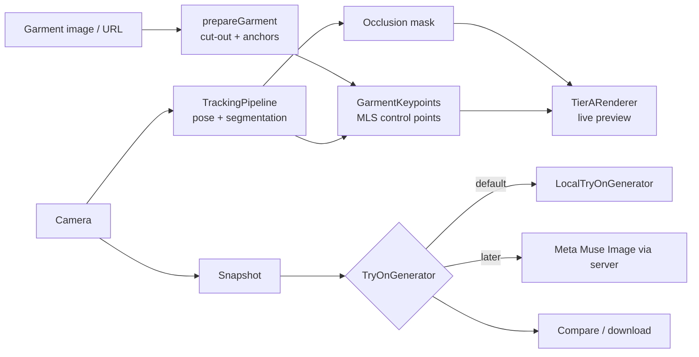

# TryAnywhere

Try on clothes from any online store with your webcam. Desktop-first web app; a browser extension comes later.

Built for Meta's Global AI Developer Hackathon (Indie track). Meta models (SAM 3.1, Muse Spark, Muse Image) plug in behind typed provider interfaces. Everything works today without any API key.

## Run it

```bash
pnpm install
pnpm setup:assets     # copies MediaPipe WASM + downloads pose/segmentation models (offline-ready; falls back to a pinned CDN if skipped)
pnpm typecheck && pnpm test
pnpm dev              # web on :5173, server on :3001
```

1. Paste a product URL (or upload a garment image) and pick the detected garment.
2. Allow the camera. Stand back so your shoulders and hips are visible and face the camera. Hints appear if not.
3. The garment follows you live. Press **Space** (or the camera button) for a **Realistic render**, which you can compare, download or retake.

Every render is kept in a session gallery (`V`) where you can re-open, download or compare two outfits side by side. Snapshots live in memory only and disappear on reload.

Shortcuts: `Space` render, `G` garment, `V` gallery, `M` mirror, `P` perf HUD, `D` debug overlay, `?` help, `Esc` close the top panel. The first visit shows a short walkthrough; reopen it with `?`. Settings has camera selection, resolution, FPS cap, the Accurate/Fast pose model and the shading strength.

## Tiers

| Tier | What | Runs | Needs a key |
|------|------|------|-------------|
| A Live Fast | WebGL2 mesh warp following your pose, with occlusion and lighting transfer | Browser | No |
| B Realistic Photo | `TryOnGenerator`. Default: `LocalTryOnGenerator` (on-device). Later: Meta Muse Image | Browser / server | No (local) / Yes (Meta) |
| C Realtime | Optional Decart realtime, off by default (`FEATURE_REALTIME_TRYON`) | Remote | Yes |

## Architecture



- `packages/engine`: all logic (camera, tracking, garment prep, renderer, providers). Strict TypeScript.
- `apps/web`: React 19 + Vite + Zustand + Tailwind v4.
- `apps/server`: Hono. URL resolve and image proxy today. Meta calls will live here only, never in the browser.

Provider interfaces live in `packages/engine/src/providers/types.ts`; `createAppRegistry` wires the keyless defaults. Connecting Meta means registering a provider under the same interface and setting `PROVIDER_*`.

## Docs

- `DECISIONS.md`: why things are built this way
- `KNOWN_LIMITATIONS.md`: what does not work yet
- `.env.example`: configuration
