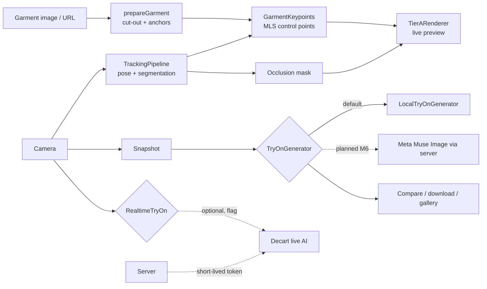

# TryAnywhere

Try on clothes from any online store with your webcam. Paste a product link, and the garment is fitted to your body live, in the browser. Desktop-first web app; a browser extension is planned after the base is solid.

Built for Meta's Global AI Developer Hackathon (Indie track). Every AI step sits behind a typed provider interface with a default that works offline and without keys, so Meta's models (SAM 3.1, Muse Spark, Muse Image) plug in by configuration. **Right now everything runs without any API key. The Meta providers are not wired in yet** (see [Status](#status)).

## Run it

```bash
pnpm install
pnpm setup:assets     # bundle the body-tracking models locally (offline-ready; falls back to a public CDN if skipped)
pnpm check:setup      # tells you what is ready and how to fix anything that is not
pnpm typecheck && pnpm test
pnpm dev              # web on http://localhost:5173, API server on :3001
```

Requires Node 20+ and pnpm 9+. Use desktop Chrome with a webcam.

1. Allow the camera. Stand back so your head, shoulders and hips are visible and face the camera. Hints tell you what to change.
2. Press **G**. Click a sample garment, paste a product page link, or upload a photo.
3. The garment follows you live. Press **Space** for a full-resolution **Realistic render**: compare before and after, download it, retake it.
4. Every render is kept in a session gallery (**V**) where you can compare two outfits side by side. Snapshots live in memory only and vanish on reload.

Shortcuts: `Space` render, `G` garment, `V` gallery, `L` live AI (if enabled), `M` mirror, `P` perf HUD, `D` debug overlay, `?` help, `Esc` close the top panel. The first visit shows a short walkthrough; reopen it with `?`.

Slow machine? Settings has camera resolution, FPS cap, the Accurate/Fast pose model, and Auto-adapt, which lowers tracking work under load and tells you when it does. Quality is the default; speed is an option.

## What it does

| Tier | What | Runs | Needs a key |
|------|------|------|-------------|
| A Live Fast | WebGL2 mesh warp that follows your pose, with occlusion (hands and hair stay in front) and lighting transfer from your own clothes | Browser | No |
| B Realistic Photo | Full-resolution re-render of one frame behind a `TryOnGenerator` interface. Default: an on-device renderer. Planned: Meta Muse Image | Browser (default) | No (default) |
| C Live AI | Optional Decart realtime AI try-on. Off by default; consent first; 5-minute cap | Third-party | Yes |

Privacy: the live preview and the default Realistic render never send your video or frames anywhere. Tier C streams your camera to Decart only after you agree, and the permanent key never reaches the browser.

## Architecture



- `packages/engine`: all logic (camera, tracking, garment prep, renderer, providers). Strict TypeScript, no vendor types.
- `apps/web`: React 19, Vite, Zustand, Tailwind v4.
- `apps/server`: Hono. URL resolving, image proxy, and the Decart token route. Secrets live here only.

### Provider slots

| Interface | Default (works now) | Planned / optional |
|---|---|---|
| `GarmentSegmenter` | Flood-fill cut-out (no model) | Meta SAM 3.1 |
| `ImageUnderstanding` | Heuristics (size, alt text, JSON-LD) | Meta Muse Spark |
| `GarmentNormalizer` | Cut-out only | Meta Muse Image |
| `TryOnGenerator` | On-device local renderer | Meta Muse Image |
| `RealtimeTryOn` | Off | Decart (built, optional); a future Meta video model |

Interfaces: `packages/engine/src/providers/types.ts`. Adding a provider is a new file plus a registry entry; the app registry is built in `apps/web/src/lib/appRegistry.ts`.

## Status

| Milestone | State |
|---|---|
| M0 Scaffold, provider layer | Done |
| M1 Camera and render pipeline | Done |
| M2 Tracking | Done |
| M3 Garment ingestion | Done, except the manual click/box select UI |
| M4 Warp renderer | Done |
| M5 Realistic Photo flow | Done with the on-device renderer; server `/api/generate` is a 501 stub |
| M6 Meta providers | **Not done.** Early work is on the local branch `m6-meta-wip`; Meta's SAM mask format could not be read, so SAM is the open item |
| M7 Polish | Done |
| M8 Live AI (Decart) | Built from the docs and tested with a fake SDK; not tried against the live service |
| M9 Demo readiness | Done (this milestone) |

## Verified and not verified

Automated: engine typecheck, 100+ unit and contract tests (filters, warp math, pose guidance, garment cut-out, fit, providers, token route, gallery logic), and headless-Chromium renders of the fit on a synthetic person.

Not verified by the author: real webcam and MediaPipe inference, the full Vite build, ESLint, the React typecheck against real React types, GPU performance, the live Decart service, and the Meta models. Run [`QA_CHECKLIST.md`](QA_CHECKLIST.md) on a real machine before showing this to anyone.

## Project docs

- [`DEMO_SCRIPT.md`](DEMO_SCRIPT.md): 2-minute demo, what to say and what not to claim
- [`QA_CHECKLIST.md`](QA_CHECKLIST.md): manual test pass
- [`KNOWN_LIMITATIONS.md`](KNOWN_LIMITATIONS.md): what does not work, plainly
- [`DECISIONS.md`](DECISIONS.md): why things are built this way
- [`.env.example`](.env.example): configuration (everything is optional)
